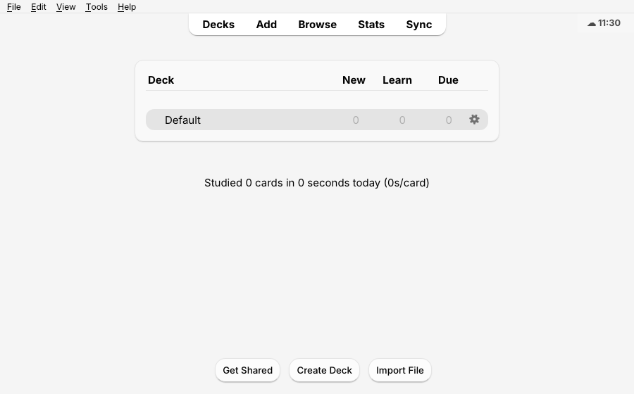
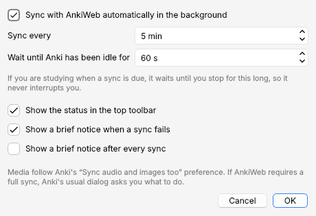

# Background Sync for Anki

Keeps Anki on your computer in sync with AnkiWeb automatically, so your phone and your other devices are always up to date. There's no progress window and nothing interrupts your study.



## What it does

- **Syncs every 5 minutes** (adjustable from 2 to 240) while Anki is open.
- **Never interrupts you.** If a sync is due while you are studying, it waits until Anki has had no keyboard or mouse input for 60 seconds (adjustable, minimum 15). It also waits while the answer side of a card is showing, while a dialog or progress window is open, and while a media sync is running.
- **Cheap when nothing changed.** It first asks AnkiWeb whether anything changed, which is the same quick check Anki uses to colour its Sync button. It only runs a real sync when there is something to send or receive.
- **Uses Anki's own sync.** Media follow your *Sync audio and images too* preference. Add-ons that listen for sync events keep working.
- **Asks before a full sync.** If AnkiWeb requires a one-way full sync, Anki's usual dialog asks whether to upload or download. If you cancel, the add-on stops asking and shows a warning until you sync manually.
- **Doesn't nag when you're offline.** If the network is down, the toolbar shows a warning and the add-on retries after 1, 2 and 4 minutes, and so on, up to your interval. You only get a brief notice if three attempts in a row fail, which avoids a notice every time the computer wakes up before Wi-Fi is back. Other errors (an AnkiWeb message, a database check required…) stop automatic retries after three attempts until you click *Sync now*.
- **Gives way to you.** If you come back and press a key while a sync is running, the sync is cancelled (nothing is lost, AnkiWeb and Anki roll back) so Anki never freezes, and it retries at the next pause.
- **Small status item** in the top toolbar (☁ 14:32): the time of the last sync. Hover for details, or click to *Sync now*, *Pause for 1 hour*, *Pause until Anki restarts*, or open *Settings…*.
- English, Spanish and French, following Anki's language.

## Settings

*Tools → Background Sync…* (or the *Config* button in the add-ons window).



## Requirements

- Anki **23.10 or newer** (tested on 23.10, 25.02 and 26.09.3).
- You must be logged in to AnkiWeb (click *Sync* once in Anki).

## Install

- **From AnkiWeb:** *Tools → Add-ons → Get Add-ons…* and paste the code from the AnkiWeb page.
- **From a release file:** download `background_sync-x.y.z.ankiaddon` and double-click it, or use *Tools → Add-ons → Install from file…*.

## Good to know

- While a sync runs (usually a second or two), Anki's collection is busy. Anything you do at that exact moment completes once the sync finishes. The idle wait makes this rare.
- After a sync, the current screen refreshes as it does after a normal sync. In the reviewer this means the card on screen is shown again (and its audio replays), which is why the add-on waits until you pause. If the Add window is open, it keeps your chosen note type and deck.
- Like any sync in Anki, a sync clears the undo history.
- It does not sync while Anki is closed. Anki's own *Automatically sync on profile open/close* option still applies.

## Development

```
src/background_sync/   the add-on (what goes into the .ankiaddon)
  __init__.py          setup: menu entry, config action, hooks
  sync_manager.py      scheduler and quiet sync (mirrors aqt.sync)
  indicator.py         toolbar item and its menu
  settings_dialog.py   settings window
  config.py            config loading and validation
  i18n.py              en / es / fr strings
tests/                 integration harness that runs real Anki offscreen
build.sh               builds dist/background_sync-<version>.ankiaddon
```

### Running the tests

The harness starts a real Anki offscreen with the add-on and a probe add-on that fakes AnkiWeb responses. It checks scheduling, idle detection, errors, full-sync handling, pausing, settings and the toolbar.

```bash
python3.11 -m venv venv && venv/bin/pip install "aqt==25.2" "anki==25.2" pyqt6 pyqt6-webengine
mkdir -p /tmp/bgs/addons21/zz_probe
cp -r src/background_sync /tmp/bgs/addons21/
cp tests/probe_addon.py /tmp/bgs/addons21/zz_probe/__init__.py
QT_QPA_PLATFORM=offscreen QTWEBENGINE_CHROMIUM_FLAGS="--no-sandbox" venv/bin/python tests/run_anki.py /tmp/bgs | grep -E "PASS|FAIL|SUMMARY"
```

## License

GNU AGPL v3 or later, the same license as Anki. See [LICENSE](LICENSE).

---

### Español

Sincroniza Anki con AnkiWeb automáticamente cada 5 minutos (ajustable), sin ventana de progreso. Si estás estudiando, espera a que pares 60 segundos para no interrumpirte. Si AnkiWeb exige una sincronización completa, te pregunta con el diálogo habitual de Anki. Un pequeño ícono ☁ en la barra superior muestra la hora de la última sincronización; haz clic para sincronizar ahora, pausar o abrir la configuración (*Herramientas → Background Sync…*).

### Français

Synchronise Anki avec AnkiWeb automatiquement toutes les 5 minutes (réglable), sans fenêtre de progression. Si vous révisez, il attend une pause de 60 secondes pour ne jamais vous interrompre. Si AnkiWeb exige une synchronisation complète, la fenêtre habituelle d'Anki vous demande quoi faire. Une petite icône ☁ dans la barre d'outils indique l'heure de la dernière synchronisation ; cliquez pour synchroniser maintenant, mettre en pause ou ouvrir les paramètres (*Outils → Background Sync…*).
